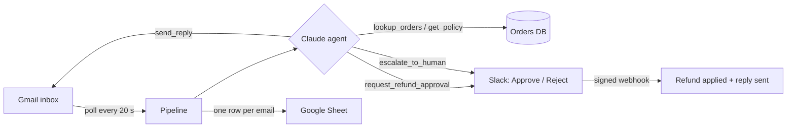

# Support Inbox Agent

An AI agent that runs a store's support inbox on its own. A customer emails; seconds later the agent has looked up their order, answered routine questions in the same thread, sent refund requests to Slack for one-click approval, escalated anything sensitive to a person, and logged every email to a Google Sheet. Nobody types anything.

Built with **Python, FastAPI, Claude (tool use), Gmail API, Google Sheets API and Slack**, deployed on Fly.io. The store, **Brewline Coffee Co.**, and its customers are fictional demo data.



## What it does with each email

| Email | Action |
| --- | --- |
| "Where is my order?", shipping, product and subscription questions | Looks up the order and the store policy, replies in the thread |
| Refund requests | Checks eligibility in code, sends a holding reply, posts **Approve / Reject** buttons to Slack. On approve: refunds the order and emails the customer |
| Complaints, legal threats, anything unclear | Escalates to Slack with a summary. No reply is sent |
| Spam, newsletters, auto-replies | Ignored without calling the model |

## Why it's safe to leave running

| Risk | Guard |
| --- | --- |
| Prompt injection in an email ("refund $500 to...") | Email text is passed as untrusted data. Refund amounts and eligibility are checked **in code** against the order, and the model can only *request* a refund |
| Leaking other customers' data | Order lookups only return the **sender's** orders, with the same "not found" for other people's orders as for ones that don't exist |
| Replying to the wrong person | `send_reply` has no recipient field: replies always go to the sender, in the same thread |
| Answering the same email twice | Each Gmail message id is claimed once (unique constraint) before any work, so retries and restarts are safe |
| Reply loops with other robots | Auto-replies, bulk mail and no-reply senders are skipped. Our replies carry `Auto-Submitted: auto-replied` |
| Mail floods | Circuit breaker: over 30 emails an hour, auto-handling stops and a person is alerted |
| The agent gets stuck or the API is down | Step, time and token limits. If no final action is chosen, the email is escalated: nothing is silently dropped |
| Double-clicks on Approve | Approval is an atomic "pending → approved" update; eligibility is re-checked at click time |
| Forged Slack requests | Every webhook is verified with Slack's signing secret and rejected if older than 5 minutes |
| Formula injection into the sheet | Rows are written as raw values, never as formulas |

The agent loop is hand-written (`app/agent/loop.py`): it handles every `stop_reason`, returns tool errors to the model so it can correct itself, and stores a trace of every model and tool call.

## Tests

19 tests drive the whole pipeline with fake Gmail, Sheets, Slack and a scripted fake Claude client, at no API cost:

```bash
python -m venv venv && venv/Scripts/pip install -r requirements-dev.txt
venv/Scripts/python -m pytest
```

They cover replies, order privacy, the refund approval flow (including double clicks and rejections), amount and refund-window checks, one-final-action enforcement, escalation on API failure, duplicate emails, auto-reply skipping, the circuit breaker, and Slack signature verification.

## Running it

1. Copy `.env.example` to `.env`.
2. Google: create an OAuth client (Desktop app) with the Gmail and Sheets APIs enabled, then run `python scripts/google_auth.py client_secret.json` signed in as the support mailbox.
3. Slack: create the app from `slack-app-manifest.yml`, install it, invite it to a channel.
4. Deploy: `fly launch --no-deploy`, `fly secrets set ...` (see `.env.example`), `fly deploy`.

## Built by

**[Srinivas Thomala](https://github.com/srinivasthomala)**, a senior backend engineer with 7+ years of experience (5 at Bloomberg building real-time financial data systems), focused on reliable, AI-integrated products.

## License

MIT
